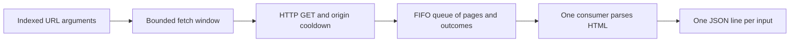

# Queued Link Extractor

List the hyperlinks from each supplied web page as JSON Lines. Up to four fetch tasks download independent pages concurrently while one consumer parses the HTML and writes each result. Only the supplied pages and their redirects are fetched.

## Build and run

Install JDK 25 and point `JAVA_HOME` at it. The Gradle Wrapper downloads Gradle and the dependencies on the first build. From the repository root, run

```sh
./gradlew clean build installDist
build/install/queued-link-extractor/bin/queued-link-extractor https://example.org/
```

Set the number of outstanding fetches with `--concurrency N` before the URLs. The supported range is 1 through 64. Use `--concurrency 1` for sequential downloads and input-order output.

On Windows, run `gradlew.bat clean build installDist` and use the `queued-link-extractor.bat` launcher under `build\install\queued-link-extractor\bin`.

## Try the packaged CLI

On macOS or Linux, set `JAVA_HOME` to JDK 25 and install `unzip`, then run the same check used by CI. It unpacks the distribution ZIP, starts the JDK web server on an available loopback port, and checks both a relative link and an HTTP 404. It prints the two JSON Lines records when they match. A launcher that takes longer than 60 seconds fails the check with its partial output and the fixture server log. Pass the exact ZIP path if the directory contains several builds.

```sh
./gradlew clean build
ci/verify-distribution.sh build/distributions/*.zip
```

To use a CI build, open a successful **Verify** run in GitHub Actions and download the **cli-distribution** artifact. Extract the artifact, then unzip the distribution inside it. With JDK 25 installed, run the launcher in its `bin` directory. The same run contains the HTML **test-reports** and **coverage-report** artifacts.

## Try two inputs manually

In one terminal, create a page and serve it with the JDK's web server.

```sh
pages=$(mktemp -d)
echo '<a href="guide">Guide</a>' > "$pages/index.html"
jwebserver -b 127.0.0.1 -p 8000 -d "$pages"
```

In another terminal, run the installed command from the repository root.

```sh
build/install/queued-link-extractor/bin/queued-link-extractor \
  --concurrency 1 http://127.0.0.1:8000/index.html http://127.0.0.1:8000/missing
```

Expected standard output

```jsonl
{"input":1,"url":"http://127.0.0.1:8000/index.html","status":"ok","links":["http://127.0.0.1:8000/guide"]}
{"input":2,"url":"http://127.0.0.1:8000/missing","status":"error","stage":"fetch","error":"HTTP 404"}
```

Stop the web server with Ctrl+C.

## Upgrading from sequential fetching

Earlier versions emitted one line per argument in input order. The default now allows four downloads. Scripts should match each result to its argument using the one-based `input` field, or pass `--concurrency 1` to preserve positional order.

## Input and output contract

Supply HTTP or HTTPS URLs as command-line arguments. Each occurrence receives its own one-based input index, including repeated URLs. Results appear in queue arrival order, so a later input can finish before an earlier one. For each input, the command emits and flushes one JSON object on standard output. A successful result contains the resolved targets of `a[href]` elements in document order, including duplicates. Relative links use the effective URI after redirects and honor an HTML base element. Targets that jsoup cannot resolve are omitted. Resolvable schemes such as `mailto:`, `tel:`, `data:`, and `javascript:` are included as text. A page with zero links produces an empty list.

Recoverable fetch and parse errors identify the input, stage, and reason. A completed batch exits with status zero, including batches with per-input errors. A failure that prevents the run from completing, such as a broken output stream, produces a nonzero exit. Fatal JVM errors terminate the batch. Running without arguments prints usage on standard error and exits with status zero. Invalid concurrency values or missing arguments after the option produce exit status 2.

### Queue overflow

By default a full queue blocks new handoffs. Pass `--overflow drop-oldest` before the URLs to make room for an arriving page or fetch error by evicting the oldest page still waiting to be parsed. Both options may appear together in either order. Example invocation

```sh
build/install/queued-link-extractor/bin/queued-link-extractor --concurrency 8 --overflow drop-oldest https://example.org/
```

An eviction produces a result such as `{"input":2,"url":"https://example.org/guide","status":"dropped"}`. The input index identifies the occurrence even if the URL appears twice. The current parse and queued errors complete normally. A reserved final slot admits the end marker after every input handoff. When output stalls, up to 16 lightweight drop notices may wait alongside the normal queue. Producers wait when that allowance is full. Use `--overflow block` to select the lossless default explicitly.

The queue holds up to 16 normal entries. Each fetch holds its slot until its handoff succeeds. The fetcher allows five seconds to connect and twenty seconds for a complete download, including the response body. It accepts up to 2 MiB of HTML or XHTML per page and reports missing or unsupported media types as fetch errors. HTTP 204 and 205 produce empty results. The HTTP charset takes precedence over an HTML charset declaration. Unfollowed redirects identify their status and destination when supplied.

### HTTP status and retry behavior

Each URL has a twenty-second deadline for the entire operation, including redirects, cooldown waits and reading the final body. The client follows up to five HTTP redirects and refuses HTTPS downgrades.

| Response | Outcome |
| --- | --- |
| 401 Unauthorized or 403 Forbidden | Emit a terminal fetch error with the HTTP status. The client sends no credentials and makes one attempt at that endpoint. |
| 429 Too Many Requests | Honor `Retry-After` in seconds or as an HTTP date. A missing or invalid header defaults to one second. Allow one retry per input and five cumulative seconds of waiting within the input deadline. |
| Another 429 after the retry, or a longer cooldown than the remaining budget | Emit a fetch error. Other inputs for that origin observe the longest outstanding server delay, even when this input gives up. |
| Other unsuccessful status or transport error | Emit a fetch error and continue processing the batch. |

Cooldowns are shared by scheme, host, and effective port. After a 429, admissions to that origin are spaced at least 100 ms apart for the rest of the batch. Cooldowns use elapsed time, so a wall-clock adjustment cannot move the retry. A URL held back by another input’s response gets an origin-cooldown diagnostic. Redirects are checked at each hop. Waiting occupies one fetch slot. Other admitted origins can proceed independently.

## Verification

`./gradlew clean build` runs both JUnit suites and checks for zero missed production lines, branches, and bytecode instructions with JaCoCo. Run `./gradlew test` for unit tests or `./gradlew integrationTest` for the CLI tests against a loopback HTTP server. Open `build/reports/jacoco/test/html/index.html` for the combined coverage report. The GitHub Actions **Verify** workflow runs the clean build on Linux and saves the coverage and test reports as downloadable artifacts.

| Behavior | Executable example |
| --- | --- |
| Multiple arrivals compete for a full queue | [PageQueueTest](src/test/java/dev/linkextractor/PageQueueTest.java) verifies which indices are dropped or retained, checks blocking in both modes, and protects fetch errors and completion. |
| Independent downloads overlap within a limit | [FetchConcurrencyIT](src/integrationTest/java/dev/linkextractor/FetchConcurrencyIT.java) holds real HTTP responses open and measures peak overlap with both the default and an explicit limit. |
| A slow final fetch leaves the queue temporarily empty | [PipelineTest](src/test/java/dev/linkextractor/PipelineTest.java) holds the final fetch open, observes the first output, then releases the fetch and checks both results. |
| Fetch or parse fails in the middle of a batch | The same suite checks every outcome, including two occurrences of the same good URL. It also checks worker shutdown after an output failure. |
| A page contains relative links, duplicates, or no anchors | [HtmlLinksTest](src/test/java/dev/linkextractor/HtmlLinksTest.java) checks the extracted list and HTML base handling. |
| A redirect changes the base URI and another page returns 404 | [LinkExtractorIT](src/integrationTest/java/dev/linkextractor/LinkExtractorIT.java) checks the JSON Lines emitted by the CLI. |

### CI examples

The [verification workflow](.github/workflows/verify.yml) builds and tests the project, runs the packaged CLI, and publishes the distribution and HTML reports. Three commented examples show where SonarQube would import JaCoCo coverage, Mend would scan dependencies, and a Linux staging runner would check the ZIP checksum, run the packaged CLI locally, and atomically switch the `current` symlink to the verified release.

## Reviewer walkthrough



Start with the [producer/consumer test](src/test/java/dev/linkextractor/PipelineTest.java). It holds the final fetch open, observes the first result at the output writer, and releases the final fetch. Run that example with

```sh
./gradlew test --tests '*PipelineTest.emitsTheFirstResultWhileTheFinalFetchIsInFlightThenDrainsAndExits*'
```

The pull requests preserve the progression from that first example through the review fixes.

| Change | Decision to inspect |
| --- | --- |
| [Basic extractor](https://github.com/Adrian-Eckardt/queued-link-extractor/pull/1) | An empty queue can still have a fetch in flight. The final handoff signals completion. |
| [Parallel downloads](https://github.com/Adrian-Eckardt/queued-link-extractor/pull/2) | A free slot admits another URL while an earlier fetch is still running. |
| [Queue overflow](https://github.com/Adrian-Eckardt/queued-link-extractor/pull/3) | Eviction releases markup and preserves an indexed outcome, with bounded memory for notices. |
| [HTTP resilience](https://github.com/Adrian-Eckardt/queued-link-extractor/pull/4) | One origin's rate limit is shared across workers. Clock adjustments and simultaneous wakeups are covered by tests. |
| [Packaged delivery](https://github.com/Adrian-Eckardt/queued-link-extractor/pull/5) | CI runs the extracted ZIP and publishes that same distribution. |

## Design and development

[ADR 0001](docs/adr/0001-application-boundaries.md) describes the application boundaries. [ADR 0002](docs/adr/0002-pipeline-completion.md) explains queue completion and worker shutdown. [ADR 0003](docs/adr/0003-bounded-fetch-concurrency.md) records how the fetch window and final handoff work. [ADR 0004](docs/adr/0004-queue-overflow.md) records the eviction and reporting policy. [ADR 0005](docs/adr/0005-http-rate-limits.md) defines the HTTP deadline, retry budget, and shared cooldown.

AI assisted with drafting the implementation and tests. During development, the overlap test failed against an initial fetch-then-parse implementation. Running the producer and consumer independently made the first page visible while the second fetch was still blocked. The commit introducing the queue includes that test and the associated decision.
