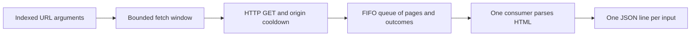

# Queued Link Extractor

Give the CLI a list of web pages and it prints one JSON object per input, with the page’s hyperlinks in document order. By default, four Java virtual threads can fetch pages concurrently while one consumer parses the HTML. The CLI follows page redirects. Extracted links are output as text.

[Run the packaged demo](#try-the-packaged-cli) · [CLI options and output](#input-and-output-contract) · [Reviewer walkthrough](#reviewer-walkthrough)

## Build and run

Install JDK 25 and point `JAVA_HOME` at it. The Gradle Wrapper downloads Gradle and the dependencies on the first build. From the repository root, run

```sh
./gradlew clean build installDist
build/install/queued-link-extractor/bin/queued-link-extractor https://example.org/
```

On Windows, run `gradlew.bat clean build installDist` and use the `queued-link-extractor.bat` launcher under `build\install\queued-link-extractor\bin`.

## Try the packaged CLI

On macOS or Linux, set `JAVA_HOME` to JDK 25 and install `unzip`, then run the same check used by CI. It unpacks the distribution ZIP, starts the JDK web server on an available loopback port, and checks both a relative link and an HTTP 404. It prints the two JSON Lines records when they match. A launcher that takes longer than 60 seconds fails the check with its partial output and the fixture server log. Pass the exact ZIP path if the directory contains several builds.

```sh
./gradlew clean build
ci/verify-distribution.sh build/distributions/*.zip
```

To use a CI build, open a successful **Verify** run in GitHub Actions and download the **cli-distribution** artifact. Extract the artifact, then unzip the distribution inside it. With JDK 25 installed, run the launcher in its `bin` directory. The same run contains the HTML **test-reports** and **coverage-report** artifacts.

<details>
<summary>Run the two-input demo manually</summary>

In one terminal, create a page and serve it with the JDK's web server.

```sh
pages=$(mktemp -d)
echo '<a href="guide">Guide</a>' > "$pages/index.html"
jwebserver -b 127.0.0.1 -p 8000 -d "$pages"
```

In another terminal, run the installed command from the repository root.

```sh
build/install/queued-link-extractor/bin/queued-link-extractor \
  --concurrency 1 http://127.0.0.1:8000/index.html http://127.0.0.1:8000/missing
```

Expected standard output

```jsonl
{"input":1,"url":"http://127.0.0.1:8000/index.html","status":"ok","links":["http://127.0.0.1:8000/guide"]}
{"input":2,"url":"http://127.0.0.1:8000/missing","status":"error","stage":"fetch","error":"HTTP 404"}
```

Stop the web server with Ctrl+C.

</details>

## Input and output contract

```text
queued-link-extractor [--concurrency N] [--overflow block|drop-oldest] URL [URL ...]
```

Place options before the first URL. The two options can appear in either order.

| Option | Default | When to change it |
| --- | --- | --- |
| `--concurrency N` | `4` | Choose 1–64 outstanding fetches. Use `1` when a downstream script needs results in argument order. |
| `--overflow` | `block` | Choose `drop-oldest` when keeping a newer page matters more than extracting every waiting page. |

Supply HTTP or HTTPS URLs. Each JSON line carries the original `url` and its one-based `input` index. Use the index to match results to arguments, even when a URL appears twice or a later download finishes first.

| Record status | What the reader receives |
| --- | --- |
| `ok` | A `links` array in document order, including duplicates. A page without anchors gives `[]`. |
| `error` | A `stage` of `fetch` or `parse` and an `error` message. Other inputs continue. |
| `dropped` | The index and URL of a page evicted while waiting for the consumer. |

Relative links resolve against the final page URI and honor an HTML base element. The parser skips unresolvable targets and preserves resolvable schemes such as `mailto:`, `tel:`, `data:` and `javascript:`.

**Exit status.** A completed batch exits with `0`, including batches with per-input errors. Read each record’s status to detect those errors. An empty command prints usage to stderr and also exits with `0`. Invalid options exit with `2`. A broken output pipe exits with `1`.

### Queue overflow

The queue holds 16 waiting pages or fetch errors. In blocking mode, a fetch worker keeps its slot until the consumer makes room. In `drop-oldest` mode an arriving page or fetch error can evict the oldest waiting page. The consumer emits a drop notice in that page’s original queue position. A page already being parsed and queued errors are protected.

Drop notices have their own 16-entry allowance. When it fills, producers wait for the consumer. The final end marker has a reserved slot so the consumer can drain every outcome and exit.

### HTTP status and retry behavior

Each URL has a five-second connection timeout and a twenty-second deadline across redirects, cooldown waits and reading the final body. The client follows up to five HTTP redirects and refuses HTTPS downgrades. It accepts up to 2 MiB of HTML or XHTML. The HTTP charset takes precedence over an HTML charset declaration. Missing or unsupported media types produce a fetch error. HTTP 204 and 205 produce empty lists.

| Response | Outcome |
| --- | --- |
| 401 Unauthorized or 403 Forbidden | Emit a terminal fetch error with the HTTP status. The client sends no credentials and makes one attempt at that endpoint. |
| 429 Too Many Requests | Honor `Retry-After` in seconds or as an HTTP date. A missing or invalid header defaults to one second. Allow one retry per input and five cumulative seconds of waiting within the input deadline. |
| Another 429 after the retry, or a longer cooldown than the remaining budget | Emit a fetch error. Other inputs for that origin observe the longest outstanding server delay, even when this input gives up. |
| Other unsuccessful status or transport error | Emit a fetch error and continue processing the batch. |

Cooldowns are shared by scheme, host, and effective port. After a 429, admissions to that origin are spaced at least 100 ms apart for the rest of the batch. Cooldowns use elapsed time, so a wall-clock adjustment cannot move the retry. A URL held back by another input’s response gets an origin-cooldown diagnostic. Redirects are checked at each hop. Waiting occupies one fetch slot. Other admitted origins can proceed independently.

**Known HTTP/2 limitation.** In a public-endpoint check, a redirect and a persistent 429 intermittently produced a timeout or a stream-cancellation error. Isolated reruns also produced the expected redirect links and retry diagnostic. The cause is still open. The loopback tests below exercise the status-handling policy using HTTP/1.1.

## Verification

`./gradlew clean build` runs both JUnit suites and checks for zero missed production lines, branches, and bytecode instructions with JaCoCo. Run `./gradlew test` for unit tests or `./gradlew integrationTest` for the CLI tests against a loopback HTTP server. Open `build/reports/jacoco/test/html/index.html` for the combined coverage report. The GitHub Actions **Verify** workflow runs the clean build on Linux and saves the coverage and test reports as downloadable artifacts.

| Behavior | Executable example |
| --- | --- |
| Multiple arrivals compete for a full queue | [PageQueueTest](src/test/java/dev/linkextractor/PageQueueTest.java) verifies which indices are dropped or retained, checks blocking in both modes, and protects fetch errors and completion. |
| A stalled writer forces queue evictions | [OverflowCliIT](src/integrationTest/java/dev/linkextractor/OverflowCliIT.java) checks the exact JSON result for all 20 inputs, including the two evicted pages. |
| A server rate-limits or denies access | [HttpPageFetcherIT](src/integrationTest/java/dev/linkextractor/HttpPageFetcherIT.java) checks request counts, retry outcomes and how redirect hops share an origin’s cooldown. |
| Independent downloads overlap within a limit | [FetchConcurrencyIT](src/integrationTest/java/dev/linkextractor/FetchConcurrencyIT.java) holds real HTTP responses open and measures peak overlap with both the default and an explicit limit. |
| A slow final fetch leaves the queue temporarily empty | [PipelineTest](src/test/java/dev/linkextractor/PipelineTest.java) holds the final fetch open, observes the first output, then releases the fetch and checks both results. |
| Fetch or parse fails in the middle of a batch | The same suite checks every outcome, including two occurrences of the same good URL. It also checks worker shutdown after an output failure. |
| A page contains relative links, duplicates, or no anchors | [HtmlLinksTest](src/test/java/dev/linkextractor/HtmlLinksTest.java) checks the extracted list and HTML base handling. |
| A redirect changes the base URI and another page returns 404 | [LinkExtractorIT](src/integrationTest/java/dev/linkextractor/LinkExtractorIT.java) checks the JSON Lines emitted by the CLI. |

### CI examples

The [verification workflow](.github/workflows/verify.yml) builds and tests the project, runs the packaged CLI, and publishes the distribution and HTML reports. Three commented examples show where SonarQube would import JaCoCo coverage, Mend would scan dependencies, and a Linux staging runner would check the ZIP checksum, run the packaged CLI locally, and atomically switch the `current` symlink to the verified release.

## Reviewer walkthrough



Trace one URL through [Pipeline](src/main/java/dev/linkextractor/Pipeline.java). The fetch worker attaches the original index and hands its page to [PageQueue](src/main/java/dev/linkextractor/PageQueue.java). Only the consumer parses pages and writes output. An empty queue can mean the last fetch is still running. The worker that completes the last handoff appends the end marker.

Start with the [producer/consumer test](src/test/java/dev/linkextractor/PipelineTest.java). It holds the final fetch open, observes the first result at the output writer, and releases the final fetch. Run that example with

```sh
./gradlew test --tests '*PipelineTest.emitsTheFirstResultWhileTheFinalFetchIsInFlightThenDrainsAndExits*'
```

The pull requests preserve the progression from that first example through the review fixes.

| Change | Decision to inspect |
| --- | --- |
| [Build foundation](https://github.com/Adrian-Eckardt/queued-link-extractor/commit/3497990) | The Gradle wrapper makes the Java build reproducible from a clean checkout. |
| [Basic extractor](https://github.com/Adrian-Eckardt/queued-link-extractor/pull/1) | An empty queue can still have a fetch in flight. The final handoff signals completion. |
| [Parallel downloads](https://github.com/Adrian-Eckardt/queued-link-extractor/pull/2) | A free slot admits another URL while an earlier fetch is still running. |
| [Queue overflow](https://github.com/Adrian-Eckardt/queued-link-extractor/pull/3) | Eviction releases markup and preserves an indexed outcome, with bounded memory for notices. |
| [HTTP resilience](https://github.com/Adrian-Eckardt/queued-link-extractor/pull/4) | One origin's rate limit is shared across workers. Clock adjustments and simultaneous wakeups are covered by tests. |
| [Packaged delivery](https://github.com/Adrian-Eckardt/queued-link-extractor/pull/5) | CI runs the extracted ZIP and publishes that same distribution. |

## Design and development

[ADR 0001](docs/adr/0001-application-boundaries.md) describes the application boundaries. [ADR 0002](docs/adr/0002-pipeline-completion.md) explains queue completion and worker shutdown. [ADR 0003](docs/adr/0003-bounded-fetch-concurrency.md) records how the fetch window and final handoff work. [ADR 0004](docs/adr/0004-queue-overflow.md) records the eviction and reporting policy. [ADR 0005](docs/adr/0005-http-rate-limits.md) defines the HTTP deadline, retry budget, and shared cooldown.

AI assisted with drafting the implementation and tests. During development, the overlap test failed against an initial fetch-then-parse implementation. Running the producer and consumer independently made the first page visible while the second fetch was still blocked. The commit introducing the queue includes that test and the associated decision.
